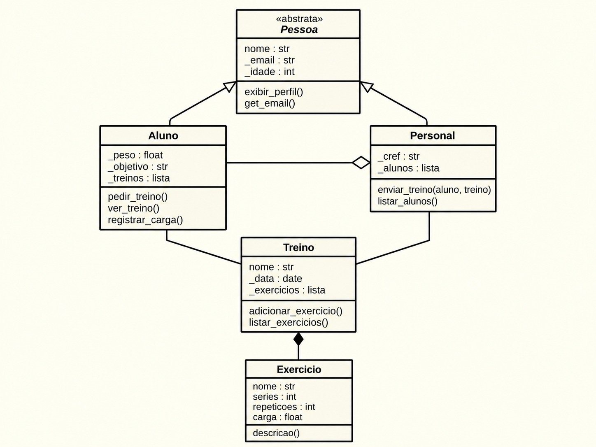

# 🏋️ App de Treino - POO em Python

Sistema simples de academia feito para a disciplina de Programação Orientada a Objetos.

## Conceitos aplicados
- **Classe abstrata**: `Pessoa`
- **Herança**: `Aluno` e `Personal` herdam de `Pessoa`
- **Agregação**: `Personal` tem alunos / `Aluno` tem treinos
- **Composição**: `Treino` cria e contém seus exercícios
- **Encapsulamento**: atributos protegidos (`_email`, `_peso`, ...)
- **Interface gráfica**: tela principal com botões em Tkinter
- **Tratamento de erros**: erros lançados com `raise ValueError` e tratados com `try/except` em vez de `return`

## Diagrama de classes


## Estrutura
```
classes.py    # Pessoa, Aluno, Personal, Treino, Exercicio
main.py       # demonstração no terminal
tela.py       # tela principal com Tkinter
```

## Como rodar
```bash
python tela.py   # interface gráfica
python main.py   # versão no terminal
```
